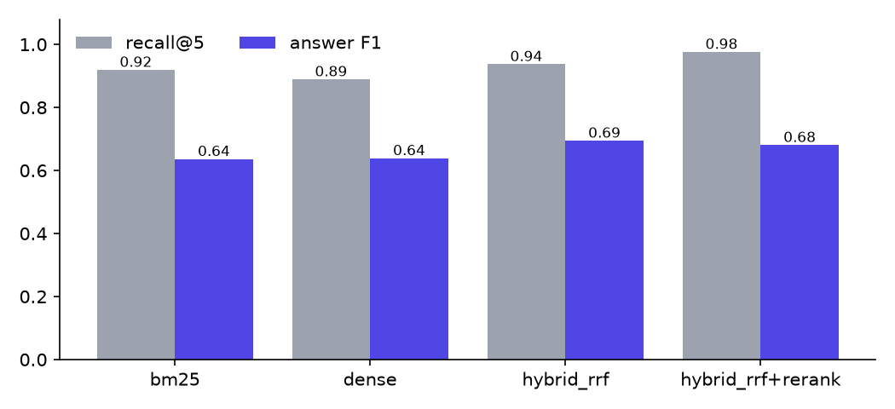
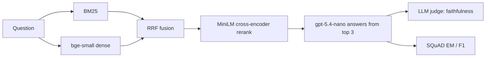

# outwitting-the-rag

[](https://github.com/PeterP22/outwitting-the-rag/actions/workflows/ci.yml) [](LICENSE)

A cheap, reproducible RAG eval harness that scores BM25, dense, hybrid and reranked retrieval on recall, answer quality, latency and cost.

**Hybrid + cross-encoder rerank: recall@5 0.976 and MRR 0.922, vs 0.919 and 0.829 for a BM25 baseline** (SQuAD v1.1 dev, 1,000 queries over 2,067 passages). Answering costs $0.13 per 1k queries with gpt-5.4-nano.





## Key decisions

- **Public, gold-labelled data.** Every SQuAD question has one gold passage and gold answers, so retrieval and answers are scored exactly. No LLM-made test set.
- **Local CPU retrieval.** bm25s, plus fastembed ONNX models for embeddings and reranking. Retrieval costs $0, and only the answer and judge calls are paid.
- **Cost from real token usage.** Each response's billed input and output tokens are multiplied by list price, and responses are cached on disk so reruns are free.
- **What didn't work:** reranking lifted MRR by 8 points but didn't improve answers (F1 0.680 vs 0.694 for plain hybrid) and added about 17x the retrieval latency. Dense retrieval alone lost to BM25, because SQuAD questions reuse the passage's wording.

## Results

The 1,000 retrieval queries and 300 generation queries were sampled with seed 0. The model is `gpt-5.4-nano` with reasoning effort `none`, answering from the top 3 passages. Retrieval latency was measured on a shared 8-vCPU box. Raw numbers are in [results/results.json](results/results.json).

| Setup | Recall@1 | Recall@5 | MRR@10 | p50 latency | EM | F1 | Faithful | $ / 1k queries |
|---|---:|---:|---:|---:|---:|---:|---:|---:|
| BM25 (baseline) | 0.765 | 0.919 | 0.829 | 0.1 ms | 0.410 | 0.636 | 85.3% | 0.125 |
| Dense (bge-small) | 0.662 | 0.889 | 0.759 | 16 ms | 0.433 | 0.639 | 91.2% | 0.124 |
| Hybrid RRF | 0.762 | 0.937 | 0.839 | 19 ms | **0.467** | **0.694** | 85.6% | 0.125 |
| Hybrid + rerank | **0.880** | **0.976** | **0.922** | 319 ms | 0.453 | 0.680 | 87.4% | 0.128 |

The full run cost $0.25 in API calls, judge included.

## Quickstart

```bash
uv sync
uv run pytest
OPENAI_API_KEY=... uv run python -m ragbench.run --retrieval-queries 1000 --gen-queries 300
```

The original book-scale RAG app lives in [legacy/](legacy/).
